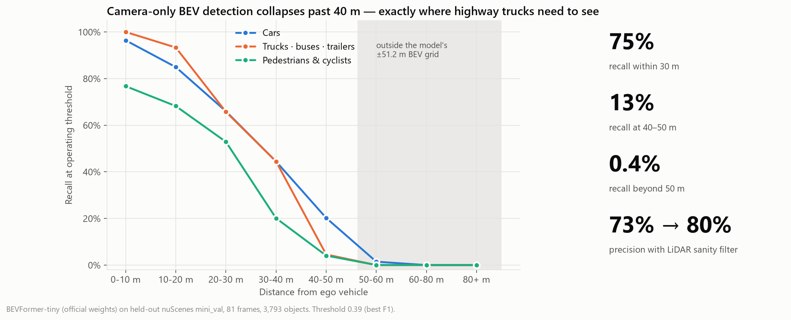
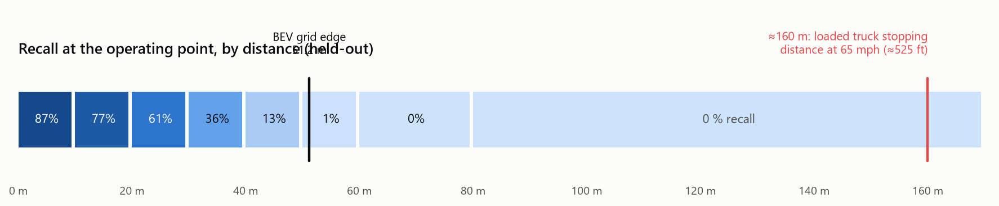
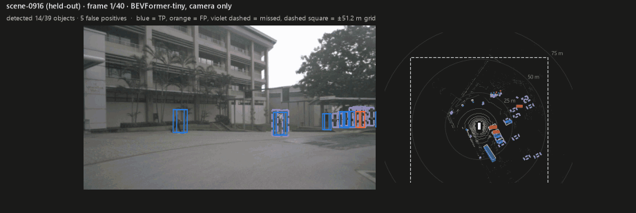
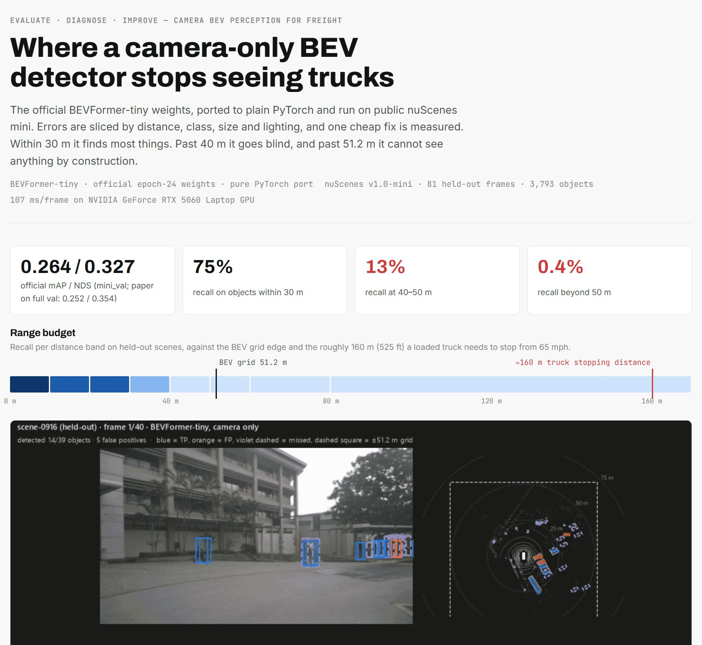
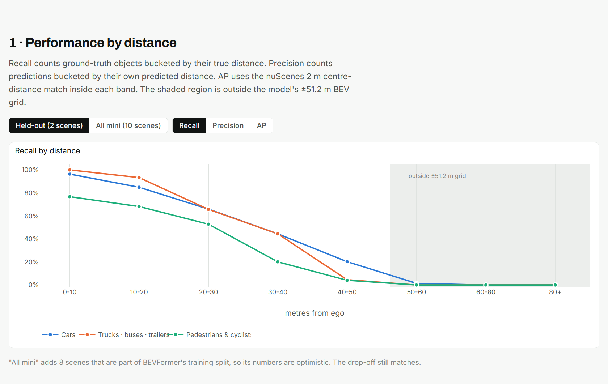
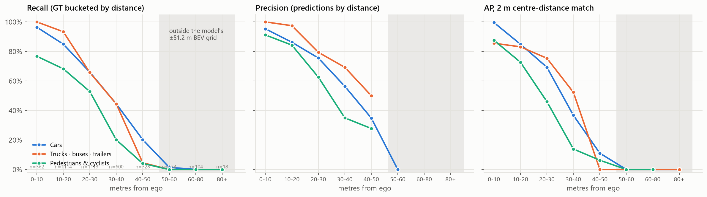
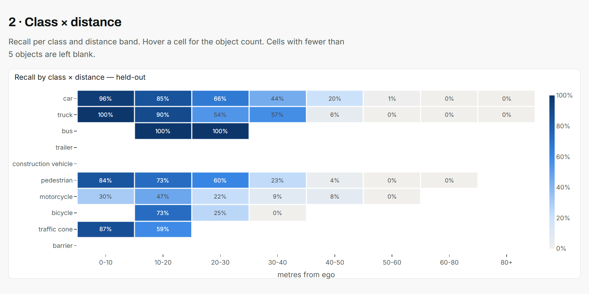

# BEV failure modes for truck-relevant scenes

<p align="center">
  <picture>
    <source media="(prefers-color-scheme: dark)" srcset="docs/assets/hero_dark.png">
    
  </picture>
</p>

<p align="center">
  <picture>
    <source media="(prefers-color-scheme: dark)" srcset="docs/assets/range_budget_dark.png">
    
  </picture>
</p>

<p align="center">
  
  <br><sub>Held-out scene, camera only. Blue = true positive, orange = false positive, violet dashed = missed, dashed square = the model's ±51.2 m BEV grid.</sub>
</p>

**One evaluate → diagnose → improve loop for camera BEV perception, scored on what matters to highway freight: range and large vehicles.**
The official pretrained BEVFormer-tiny weights, ported to plain PyTorch (no mmcv, no custom CUDA ops), are run on public nuScenes mini. The baseline is reproduced with the official devkit, errors are sliced by distance, class, size, lighting and visibility, every miss and false positive is tagged with a failure type, and one cheap fix is measured.

### The report at a glance

<picture><source media="(prefers-color-scheme: dark)" srcset="docs/assets/report/overview_dark.jpg"></picture>

## Headline results

| | Held-out `mini_val` (2 scenes, 81 frames, 3,793 objects) |
|---|---|
| Official nuScenes **mAP / NDS** | **0.264 / 0.327** (published on full val: 0.252 / 0.354) |
| Recall within 30 m | **75 %** |
| Recall at 40–50 m | **13 %** |
| Recall beyond 50 m | **0.4 %**. The BEV grid ends at ±51.2 m, so these objects cannot be detected by construction. |
| Large-vehicle recall beyond 50 m (all 10 mini scenes) | **0.9 %** |
| **Fix: LiDAR sanity filter** | precision **73 % → 80 %**, recall 56 % → 53 %, mAP **+0.005**, NDS **+0.004** |
| Rejected: range-aware thresholds | cross-scene F1 **0.629 → 0.563** (overfits; reported anyway) |
| Speed | ~100–110 ms/frame, 626 MB peak GPU memory (RTX 5060 Laptop) |

## What the slicing shows

<picture><source media="(prefers-color-scheme: dark)" srcset="docs/assets/report/range_dark.png"></picture>

Recall, precision and AP side by side:

<picture><source media="(prefers-color-scheme: dark)" srcset="docs/assets/range_metrics_dark.png"></picture>

1. **Range is the dominant failure.** Recall falls from 96 % (cars, 0–10 m) to 20 % at 40–50 m and to zero past the grid. Precision falls with it (91 % → 34 %), so the few far detections are also mostly wrong. For a truck that needs about 160 m to stop from 65 mph, the usable perception horizon here is about 30 m.
2. **Large vehicles fall off a cliff.** Trucks and buses are found 93–100 % of the time within 20 m, but only 5 % at 40–50 m (n=22) and 0 % beyond. Their extra size does not buy extra range.

<picture><source media="(prefers-color-scheme: dark)" srcset="docs/assets/report/heatmap_dark.png"></picture>

Held-out scenes next to all 10 mini scenes (8 of which were in training):

<picture><source media="(prefers-color-scheme: dark)" srcset="docs/assets/class_range_heatmap_dark.png"></picture>

3. **Size matters at range, and depth error grows with it.** In all 10 mini scenes, 8–12 m vehicles are found 81 % of the time within 40 m but 3 % at 40 m or more. Boxes longer than 12 m (articulated buses, trailers) reach only 50 % recall even within 40 m. Median BEV centre error grows from 0.3 m (0–10 m) to about 1.1 m (40–50 m) for cars.
4. **Night is not the problem here.** Night recall tracks day recall at every range. The three night scenes are in BEVFormer's training split, though, so this is an upper bound and not a robustness claim.

<picture><source media="(prefers-color-scheme: dark)" srcset="docs/assets/report/size_loc_dark.png"></picture>

5. **Depth is the root error.** The largest false-positive tag is *"real object, placed 2–4 m off in depth"*: 350 of 773 held-out FPs. Then come duplicates (186) and ghosts with no LiDAR returns at all (173). Among misses, objects the model found but scored below threshold dominate inside 50 m; past 50 m every miss is outside the grid.

<picture><source media="(prefers-color-scheme: dark)" srcset="docs/assets/report/failures_dark.png"></picture>

Misses and false positives side by side:

<picture><source media="(prefers-color-scheme: dark)" srcset="docs/assets/failures_dark.png"></picture>

## Worst-case gallery

Frames ranked by missed large vehicles (×3), other in-grid misses and confident false positives. Each card shows the camera with the most failures (every box projected into it) beside the bird's-eye view, with an automatic one-line diagnosis. Blue = true positive, orange = false positive, violet dashed = missed, yellow circle = the failure the diagnosis is about. Full-size frames are in [`docs/assets/gallery/`](docs/assets/gallery).

<picture><source media="(prefers-color-scheme: dark)" srcset="docs/assets/report/gallery_dark.jpg"></picture>

## The fix: LiDAR sanity filter

Drop any camera box whose box, grown by 0.5 m on every side, contains no LiDAR return. LiDAR only vetoes boxes; it never moves or creates one. The setting (≥1 point, +0.5 m) was fixed before evaluation (highlighted row), and the sweep shows how sensitive it is.

<picture><source media="(prefers-color-scheme: dark)" srcset="docs/assets/report/fix_dark.png"></picture>

The un-grown variant *hurts* (−3.3 mAP points). It deletes correct detections whose boxes are shifted in depth, which confirms the depth finding from another angle.

## Recommendations

1. **Widen the BEV grid first.** 14 % of held-out misses lie past 51.2 m and are structurally undetectable. Train with ≥ ±100 m forward range, using a non-uniform or polar grid to keep near-field resolution.
2. **Get more pixels on distant targets.** The model sees 800×450 inputs, where a 2.5 m-wide truck at 80 m is about 20 px wide. Add a narrow-FOV long-range camera at full resolution.
3. **Attack depth, not thresholds.** Depth supervision (BEVDepth-style LiDAR targets) or radar fusion targets the largest FP class and the error growth with range.
4. **Ship the LiDAR veto as a runtime guard**, always with a box margin.
5. **Don't fit per-range thresholds on small data.** They overfit across scenes. Recalibrate on a large held-out set instead.
6. **Add articulated / >12 m vehicles as a tracked slice in CI**, using the same code.

## Reproduce

```bash
python -m venv .venv && .venv/Scripts/activate          # Linux/macOS: source .venv/bin/activate
pip install torch torchvision --index-url https://download.pytorch.org/whl/cu128
pip install -r requirements.txt
./scripts/setup_data.ps1                                # or: bash scripts/setup_data.sh  (~5.4 GB)
python -m bevdiag run                                   # inference -> official eval -> slicing -> fix -> figures
python -m pytest -q                                     # 13 tests (3 need the data / checkpoint)
```

`python -m bevdiag run` writes `outputs/` (raw predictions, devkit metrics, per-object tables, `summary.json`) and regenerates every figure in `docs/`. It caps itself at **90 % of CPU threads and GPU memory** and runs at below-normal priority, so the machine stays responsive (`--budget 0.7` to use less). A full run takes about 3 minutes on an RTX 5060 Laptop GPU.

## How it works

| File | What it does |
|---|---|
| [`bevdiag/model.py`](bevdiag/model.py) | Pure-PyTorch BEVFormer-tiny: ResNet-50 + FPN, 3-layer encoder (temporal self-attention + spatial cross-attention), 6-layer decoder, NMS-free coder. Loads the official checkpoint with zero missing keys. |
| [`bevdiag/data.py`](bevdiag/data.py) | nuScenes → per-frame camera tensors, `lidar2img`, and the 18-d CAN-bus vector built exactly as the reference converter builds it. |
| [`bevdiag/diagnose.py`](bevdiag/diagnose.py) | nuScenes-style matcher (cross-checked against the devkit in tests, *without* the 50 m cut-off), range/size/class/visibility slices, failure tagging. |
| [`bevdiag/fixes.py`](bevdiag/fixes.py) | LiDAR sanity filter; range-aware thresholds with cross-scene validation. |
| [`bevdiag/report.py`](bevdiag/report.py), [`viz.py`](bevdiag/viz.py), [`html.py`](bevdiag/html.py) | Light and dark figures, gallery, GIF, and the HTML report (`docs/index.html`) the screenshots above come from. |
| [`tests/`](tests) | Deformable attention vs a naive bilinear reference, point-in-box vs the devkit, AP/matching identical to the devkit, CAN-bus quirk, strict checkpoint load, official-metric regression. |

**Why a port instead of MMDetection3D?** mmcv's compiled ops don't build against PyTorch ≥ 2.7, which RTX 50-series (sm_120) GPUs need, and this Windows laptop has no CUDA toolkit. The port keeps the reference module names so the state dict maps 1:1. It replaces the custom deformable-attention kernel with `grid_sample` (same math, tested), and matches the published mAP within the noise expected on mini.

## Caveats

- nuScenes **mini** is small. Held-out `mini_val` has 2 scenes, 163 large vehicles and no trailers. Slices marked *all mini* include 8 scenes from BEVFormer's training split and are optimistic. They are used only where held-out counts are too small (lighting, >12 m vehicles), and are always labelled.
- "Recall at threshold" uses one operating threshold (0.39, best F1 on held-out). AP numbers are threshold-free.
- Failure tags are rule-based (priority order is in `diagnose.tag_failures`). A "ghost with LiDAR points" may be an unlabelled real object.

Data: [nuScenes](https://www.nuscenes.org) (CC BY-NC-SA 4.0). Model: [BEVFormer](https://github.com/fundamentalvision/BEVFormer) (Apache-2.0), official `bevformer_tiny_epoch_24.pth`.
