# BEV failure modes for truck-relevant scenes: diagnosed, then improved

<p align="center">
  <picture>
    <source media="(prefers-color-scheme: dark)" srcset="docs/assets/improve_hero_dark.png">
    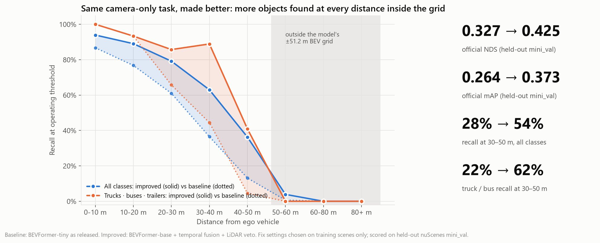
  </picture>
</p>

<p align="center">
  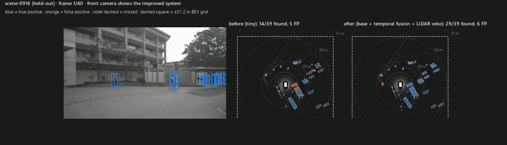
  <br><sub>Held-out scene, camera only. Middle: BEVFormer-tiny as released. Right: the improved system. Blue = true positive, orange = false positive, violet dashed = missed, dashed square = the ±51.2 m BEV grid.</sub>
</p>

**One evaluate → diagnose → improve loop for camera BEV perception, scored on what matters to highway freight: range and large vehicles.**

I started from an existing open-source detector, BEVFormer-tiny with its official pretrained weights, and reproduced its published accuracy on public nuScenes mini. I sliced its errors by distance, class, size and lighting and tagged every failure. Then I made the system measurably better:

1. **Ported the stronger released BEVFormer checkpoints (small and base) to plain PyTorch.** These need MMDetection3D's compiled CUDA ops, which don't build for RTX 50-series GPUs. My port replaces them with tested PyTorch equivalents, so base runs on an 8 GB laptop GPU (3 GB peak).
2. **Built two inference-time fixes aimed at the diagnosed failures.** *Temporal score fusion* targets the largest miss category, objects found but scored too low. A *LiDAR veto* targets ghost boxes. Both fix settings were chosen on training scenes only, and both help all three models on held-out data.

Nothing was retrained. Every number below is the official nuScenes devkit score on the 2 held-out `mini_val` scenes (81 frames, 3,793 objects).

## Before → after

| Held-out `mini_val` | Baseline: BEVFormer-tiny as released | Improved: BEVFormer-base + temporal fusion + LiDAR veto | Change |
|---|---|---|---|
| Official **NDS** | 0.327 | **0.425** | **+30 %** |
| Official **mAP** | 0.264 | **0.373** | **+41 %** |
| Recall within 30 m | 71 % | **85 %** | +14 pts |
| Recall at 30–50 m | 28 % | **54 %** | ×1.9 |
| **Truck / bus recall at 30–50 m** | 22 % | **62 %** | **×2.8** |
| Precision at the operating point | 73 % | **84 %** | +11 pts |
| False positives (81 frames) | 773 | **510** | −34 % |
| Misses inside the BEV grid | 1,448 | **843** | −42 % |
| Recall beyond 51.2 m | 0 % | 0 % | unchanged: no model has a grid that reaches that far |
| Speed (RTX 5060 Laptop) | 107 ms/frame | 1.04 s/frame | slower, see caveats |

### Where the gain comes from

<picture><source media="(prefers-color-scheme: dark)" srcset="docs/assets/improve_ladder_dark.png">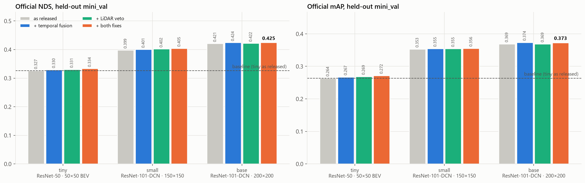</picture>

| Model | as released | + temporal fusion | + LiDAR veto | + both | published on full val (NDS / mAP) |
|---|---|---|---|---|---|
| tiny (ResNet-50, 50×50 BEV, half-res input) | 0.327 / 0.264 | 0.330 / 0.267 | 0.331 / 0.269 | **0.334 / 0.272** | 0.354 / 0.252 |
| small (ResNet-101-DCN, 150×150, 0.8× input) | 0.399 / 0.353 | 0.401 / 0.355 | 0.402 / 0.355 | **0.405 / 0.356** | 0.479 / 0.370 |
| base (ResNet-101-DCN, 200×200, full-res, 4 levels) | 0.421 / 0.369 | 0.424 / 0.374 | 0.422 / 0.369 | **0.425 / 0.373** | 0.517 / 0.416 |

<sub>Cells are official NDS / mAP on held-out mini_val. NDS on mini runs below the published full-val numbers for every model because mini_val has no trailers, construction vehicles or barriers, and the devkit charges those classes full error.</sub>

- **The bigger port does most of the work**: +0.095 NDS from tiny to base. The extra input resolution and the finer 200×200 BEV grid are exactly what the diagnosis asked for, since range and depth were the dominant failures.
- **The two fixes add a smaller but consistent gain**: +0.004 to +0.007 NDS on every model, and for each model the combination that scored best on the training scenes was also the best on held-out NDS. Temporal fusion recovers objects the model sees in consecutive frames but scores low. The LiDAR veto removes boxes with no physical support.
- The final system was picked by training-scene NDS, before looking at held-out results.

### Before vs after, by distance, class and failure type

<picture><source media="(prefers-color-scheme: dark)" srcset="docs/assets/improve_range_dark.png">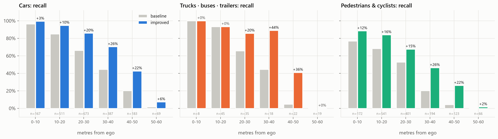</picture>

<picture><source media="(prefers-color-scheme: dark)" srcset="docs/assets/improve_class_ap_dark.png">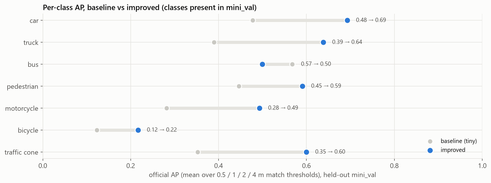</picture>

<picture><source media="(prefers-color-scheme: dark)" srcset="docs/assets/improve_errors_dark.png">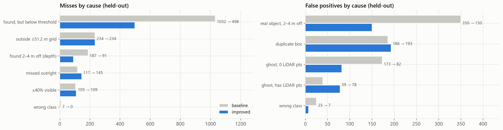</picture>

Depth-shifted boxes, duplicates and ghosts with no LiDAR support all drop sharply. Misses outside the 51.2 m grid don't change, because no released checkpoint covers that range.

### The worst baseline frames, re-run with the improved system

<picture><source media="(prefers-color-scheme: dark)" srcset="docs/assets/compare/compare_00_dark.jpg">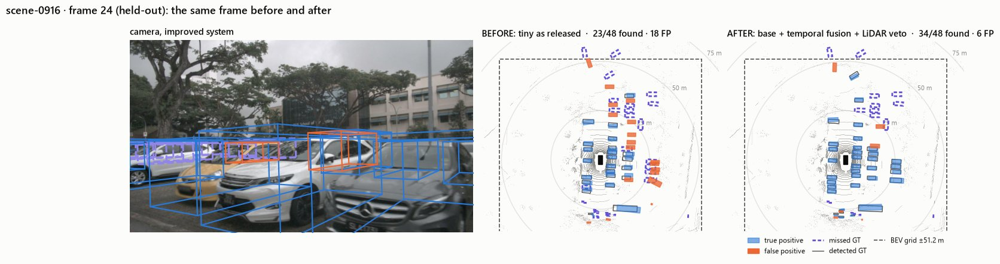</picture>

**scene-0916 · frame 24:** found 23 → **34** of 48 objects; false positives 18 → **6**.

<picture><source media="(prefers-color-scheme: dark)" srcset="docs/assets/compare/compare_01_dark.jpg">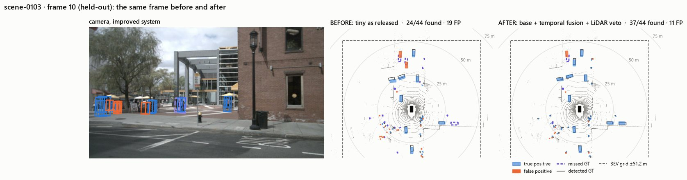</picture>

**scene-0103 · frame 10:** found 24 → **37** of 44; false positives 19 → **11**.

<picture><source media="(prefers-color-scheme: dark)" srcset="docs/assets/compare/compare_02_dark.jpg">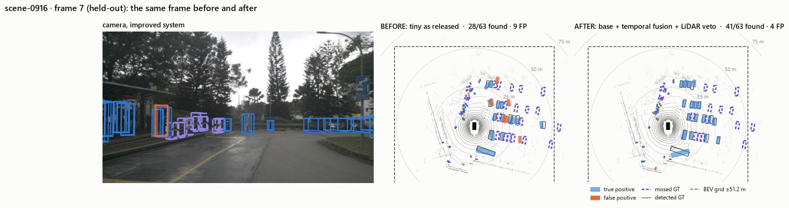</picture>

**scene-0916 · frame 7:** found 28 → **41** of 63; false positives 9 → **4**.

<picture><source media="(prefers-color-scheme: dark)" srcset="docs/assets/compare/compare_03_dark.jpg">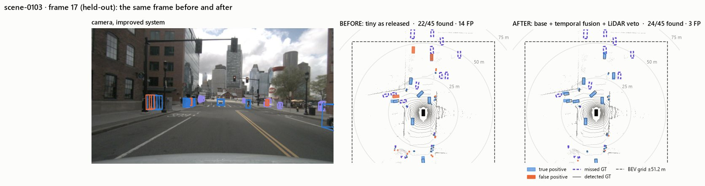</picture>

**scene-0103 · frame 17:** found 22 → **24** of 45; false positives 14 → **3**. The truck at 57 m is still missed, because it is outside the grid.

---

# Part 2: Diagnosis of the baseline

Everything below is the original failure analysis of BEVFormer-tiny as released. It is what pointed at range, depth and low-confidence detections as the things to fix.

<p align="center">
  <picture>
    <source media="(prefers-color-scheme: dark)" srcset="docs/assets/range_budget_dark.png">
    
  </picture>
</p>

<picture><source media="(prefers-color-scheme: dark)" srcset="docs/assets/report/overview_dark.jpg"></picture>

| Baseline, held-out `mini_val` | |
|---|---|
| Official nuScenes **mAP / NDS** | **0.264 / 0.327** (published on full val: 0.252 / 0.354) |
| Recall within 30 m | **75 %** (mean of the three 10 m bands) |
| Recall at 40–50 m | **13 %** |
| Recall beyond 50 m | **0.4 %**. The BEV grid ends at ±51.2 m, so these objects cannot be detected by construction. |
| Large-vehicle recall beyond 50 m (all 10 mini scenes) | **0.9 %** |
| LiDAR veto alone | precision **73 % → 80 %**, recall 56 % → 53 %, mAP **+0.005**, NDS **+0.004** |
| Rejected: range-aware thresholds | cross-scene F1 **0.629 → 0.563** (overfits; reported anyway) |

## What the slicing shows

<picture><source media="(prefers-color-scheme: dark)" srcset="docs/assets/report/range_dark.png"></picture>

Recall, precision and AP side by side:

<picture><source media="(prefers-color-scheme: dark)" srcset="docs/assets/range_metrics_dark.png"></picture>

1. **Range is the dominant failure.** Recall falls from 96 % (cars, 0–10 m) to 20 % at 40–50 m and to zero past the grid. Precision falls with it (91 % → 34 %), so the few far detections are also mostly wrong. For a truck that needs about 160 m to stop from 65 mph, the usable perception horizon here is about 30 m.
2. **Large vehicles fall off a cliff.** Trucks and buses are found 93–100 % of the time within 20 m, but only 5 % at 40–50 m (n=22) and 0 % beyond. Their extra size does not buy extra range.

<picture><source media="(prefers-color-scheme: dark)" srcset="docs/assets/report/heatmap_dark.png"></picture>

Held-out scenes next to all 10 mini scenes (8 of which were in training):

<picture><source media="(prefers-color-scheme: dark)" srcset="docs/assets/class_range_heatmap_dark.png">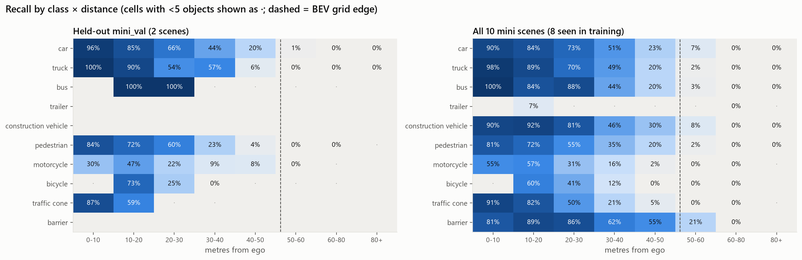</picture>

3. **Size matters at range, and depth error grows with it.** In all 10 mini scenes, 8–12 m vehicles are found 81 % of the time within 40 m but 3 % at 40 m or more. Boxes longer than 12 m (articulated buses, trailers) reach only 50 % recall even within 40 m. Median BEV centre error grows from 0.3 m (0–10 m) to about 1.1 m (40–50 m) for cars.
4. **Night is not the problem here.** Night recall tracks day recall at every range. The three night scenes are in BEVFormer's training split, though, so this is an upper bound and not a robustness claim.

<picture><source media="(prefers-color-scheme: dark)" srcset="docs/assets/report/size_loc_dark.png">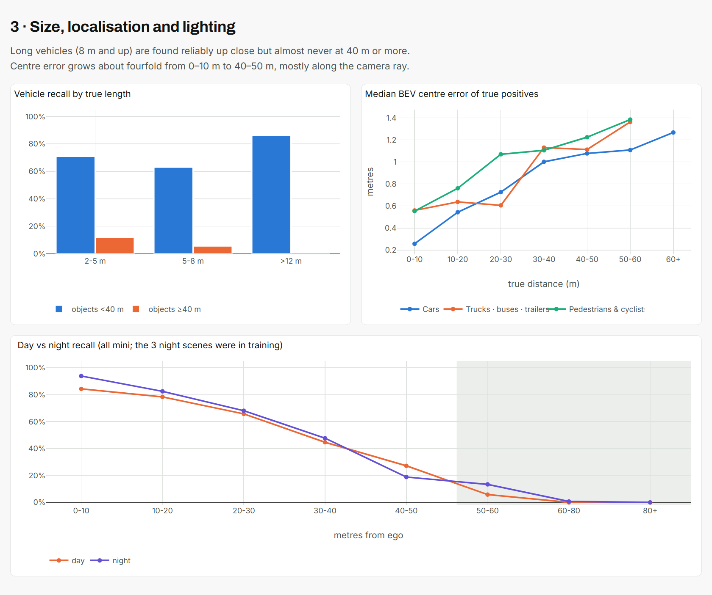</picture>

5. **Depth is the root error.** The largest false-positive tag is *"real object, placed 2–4 m off in depth"*: 350 of 773 held-out FPs. Then come duplicates (186) and ghosts with no LiDAR returns at all (173). Among misses, objects the model found but scored below threshold dominate inside 50 m; past 50 m every miss is outside the grid.

<picture><source media="(prefers-color-scheme: dark)" srcset="docs/assets/report/failures_dark.png">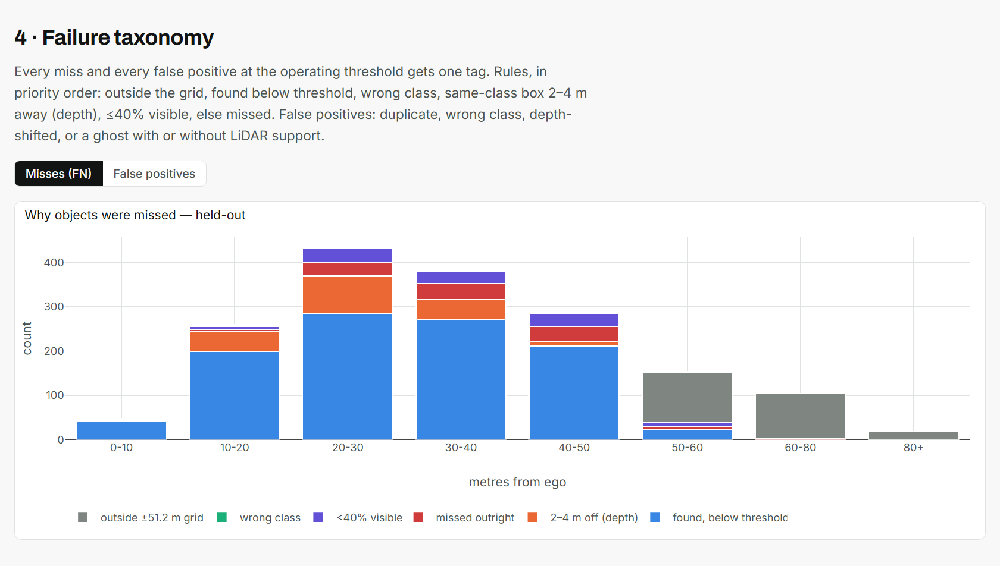</picture>

Misses and false positives side by side:

<picture><source media="(prefers-color-scheme: dark)" srcset="docs/assets/failures_dark.png">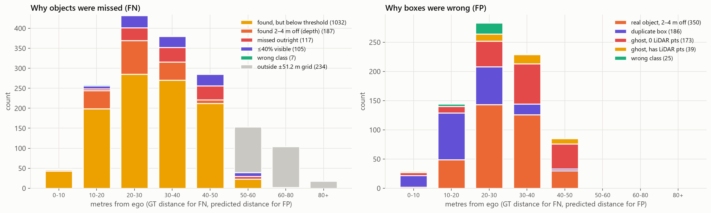</picture>

## Worst-case gallery

Frames ranked by missed large vehicles (×3), other in-grid misses and confident false positives. Each card shows the camera with the most failures (every box projected into it) beside the bird's-eye view, with an automatic one-line diagnosis. Blue = true positive, orange = false positive, violet dashed = missed, yellow circle = the failure the diagnosis is about. Full-size frames are in [`docs/assets/gallery/`](docs/assets/gallery).

<picture><source media="(prefers-color-scheme: dark)" srcset="docs/assets/report/gallery_dark.jpg">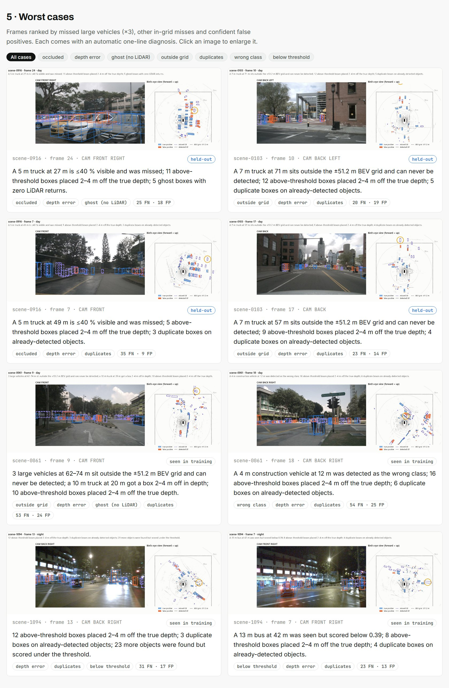</picture>

## The first fix tested: LiDAR sanity filter (on tiny)

Drop any camera box whose box, grown by 0.5 m on every side, contains no LiDAR return. LiDAR only vetoes boxes; it never moves or creates one. The setting (≥1 point, +0.5 m) was fixed before evaluation (highlighted row), and the sweep shows how sensitive it is.

<picture><source media="(prefers-color-scheme: dark)" srcset="docs/assets/report/fix_dark.png">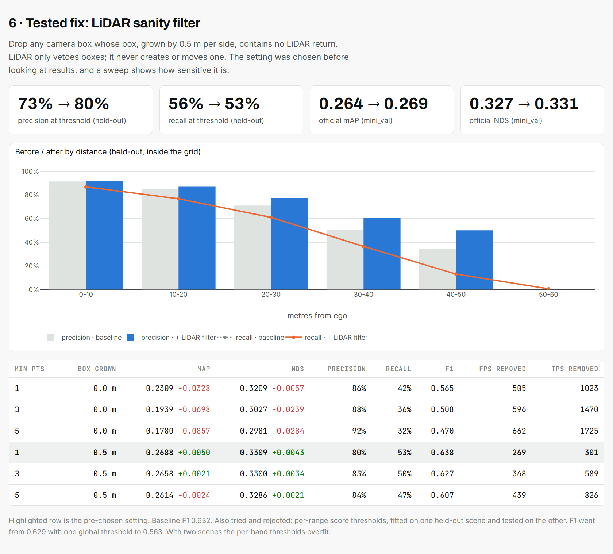</picture>

The un-grown variant *hurts* (−3.3 mAP points). It deletes correct detections whose boxes are shifted in depth, which confirms the depth finding from another angle.

## Recommendations

What's done here, and what it would take to go further:

1. **Done: more pixels and a finer grid.** Moving to the full-resolution, 200×200-grid model almost tripled truck/bus recall at 30–50 m. Next step: a narrow-FOV long-range camera at full resolution. At the tiny model's input scale, a 2.5 m-wide truck 80 m away is about 20 px wide.
2. **Done: use time.** Temporal score fusion helps every model at near-zero cost (one nearest-neighbour match per box per frame). A full tracker with track-level scoring is the natural next step.
3. **Done: a LiDAR veto as a runtime guard**, always with a box margin. Without the 0.5 m margin it deletes correct but depth-shifted boxes and costs 3.3 mAP points.
4. **Still open: the 51.2 m wall.** 14 % of baseline held-out misses lie past the grid, and they stay at 0 % after every improvement here. Fixing it needs retraining with at least ±100 m forward range (a non-uniform or polar grid keeps near-field resolution) on data annotated that far out. nuScenes only scores to 50 m.
5. **Still open: depth.** Depth supervision from LiDAR (BEVDepth-style) or radar fusion attacks the error that grows with range.
6. **Don't fit per-range thresholds on small data.** They overfit across scenes. Recalibrate on a large held-out set instead.

## Reproduce

```bash
python -m venv .venv && .venv/Scripts/activate          # Linux/macOS: source .venv/bin/activate
pip install torch torchvision --index-url https://download.pytorch.org/whl/cu128
pip install -r requirements.txt
./scripts/setup_data.ps1                                # or: bash scripts/setup_data.sh  (~6.4 GB incl. 3 checkpoints)
python -m bevdiag run                                   # all 3 models -> official eval -> slicing -> fixes -> figures
python -m bevdiag run --models tiny                     # baseline only, about 3 minutes
python -m pytest -q                                     # 18 tests (5 need the data / checkpoints)
```

`python -m bevdiag run` writes `outputs/` (raw predictions per model, devkit metrics, per-object tables, `summary.json`, `improve/improvement.json`) and regenerates every figure in `docs/`. It caps itself at **90 % of CPU threads and GPU memory** and runs at below-normal priority, so the machine stays responsive (`--budget 0.7` to use less). A full three-model run from scratch takes about 40 minutes on an RTX 5060 Laptop GPU. Inference is about 12 minutes of that; the rest is 51 official devkit evaluations.

## How it works

| File | What it does |
|---|---|
| [`bevdiag/model.py`](bevdiag/model.py) | Pure-PyTorch BEVFormer tiny / small / base: mmdet-compatible ResNet-50/101 (pytorch or caffe style, DCNv2 via `torchvision.ops.deform_conv2d`), multi-level FPN, temporal self-attention + spatial cross-attention encoder, 6-layer decoder, NMS-free coder. Loads all three official checkpoints with zero missing keys. |
| [`bevdiag/data.py`](bevdiag/data.py) | nuScenes → per-frame camera tensors (per-model scale and normalisation), `lidar2img`, and the 18-d CAN-bus vector built exactly as the reference converter builds it. |
| [`bevdiag/diagnose.py`](bevdiag/diagnose.py) | nuScenes-style matcher (cross-checked against the devkit in tests, *without* the 50 m cut-off), range/size/class/visibility slices, failure tagging. |
| [`bevdiag/fixes.py`](bevdiag/fixes.py) | Temporal score fusion, LiDAR veto, range-aware thresholds (rejected). |
| [`bevdiag/improve.py`](bevdiag/improve.py) | The improvement ladder: tunes temporal fusion on `mini_train`, picks the final system by `mini_train` NDS, scores every rung once on held-out `mini_val`. |
| [`bevdiag/report.py`](bevdiag/report.py), [`viz.py`](bevdiag/viz.py), [`viz_compare.py`](bevdiag/viz_compare.py) | Light and dark figures, galleries and GIFs. |
| [`tests/`](tests) | Deformable attention vs a naive bilinear reference, DCNv2 vs a plain conv, FPN shapes, point-in-box vs the devkit, AP/matching identical to the devkit, temporal-fusion behaviour, CAN-bus quirk, strict checkpoint loads, official-metric regression. |

**Why a port instead of MMDetection3D?** mmcv's compiled ops don't build against PyTorch ≥ 2.7, which RTX 50-series (sm_120) GPUs need, and this Windows laptop has no CUDA toolkit. The port keeps the reference module names so each state dict maps 1:1. It replaces the custom deformable-attention and DCNv2 kernels with `grid_sample` and `torchvision.ops.deform_conv2d` (same math, tested). It reproduces the published mAP within the noise expected on mini: 0.264 vs 0.252 for tiny, 0.353 vs 0.370 for small, 0.369 vs 0.416 for base.

## Caveats

- nuScenes **mini** is small. Held-out `mini_val` has 2 scenes, 163 large vehicles and no trailers, so per-bucket numbers carry real noise. Slices marked *all mini* include 8 scenes from BEVFormer's training split and are optimistic. They are used only where held-out counts are too small, and are always labelled.
- The improvement comes from **released checkpoints plus inference-time fixes, not new training**. Fix settings and the final configuration were chosen on `mini_train` (seen in training), never on the held-out scenes.
- The improved system is **about 10× slower** (1.04 s vs 0.11 s per frame in fp32 on a laptop GPU). For deployment, try fp16/TensorRT, or BEVFormer-small (0.42 s/frame), which keeps most of the gain.
- "Recall at threshold" uses each system's own best-F1 operating threshold on held-out (0.39 for the baseline). AP and NDS numbers are threshold-free.
- Failure tags are rule-based (priority order is in `diagnose.tag_failures`). A "ghost with LiDAR points" may be an unlabelled real object.

Data: [nuScenes](https://www.nuscenes.org) (CC BY-NC-SA 4.0). Model: [BEVFormer](https://github.com/fundamentalvision/BEVFormer) (Apache-2.0), official `bevformer_tiny_epoch_24.pth`, `bevformer_small_epoch_24.pth`, `bevformer_r101_dcn_24ep.pth`.
